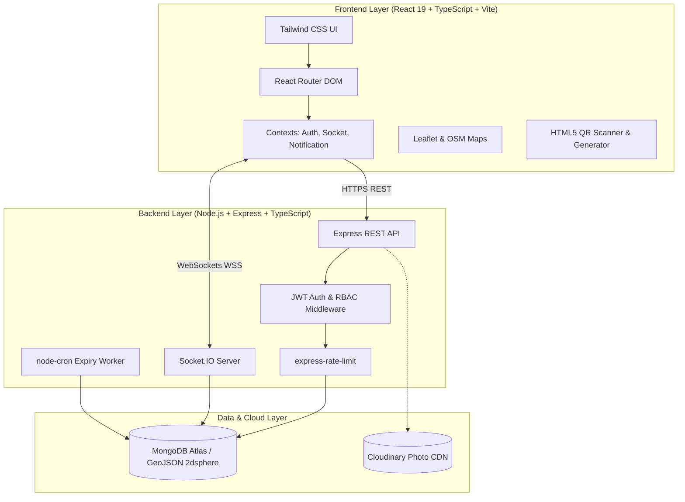

# ParkZee – Architecture & System Design Documentation

## 1. High-Level Architectural Overview

ParkZee is built on the MERN (MongoDB, Express, React, Node.js) technology stack, utilizing TypeScript end-to-end for type safety and structural rigor.

---

## 2. Core Architectural Pillars

### A. Role-Based Access Control (RBAC)
The platform enforces three distinct user roles:
1. **DRIVER**: Discovers nearby parking, reserves slots, pays hosts offline, views entry QR passes, submits reviews and incident reports.
2. **OWNER**: Lists parking facilities, configures operating hours and pricing, confirms direct payments received offline, scans driver QR codes, performs check-in/out.
3. **ADMIN**: Verifies and approves parking listings, suspends/reactivates accounts, audits direct payment receipts, resolves dispute tickets, monitors system analytics.

### B. Concurrency-Safe Booking Engine
- **Formula**: Overlap condition is strictly evaluated as `newStart < existingEnd && newEnd > existingStart`.
- **Active State Filtering**: Overlap evaluations count bookings in `RESERVED_AWAITING_OWNER_CONFIRMATION`, `CONFIRMED`, and `CHECKED_IN`.
- **Double-Layer Concurrency Guard**:
  - Process-level mutex per parking facility (`async-mutex`) serializes overlap checks for concurrent incoming requests.
  - Database-level compound index (`parkingLocationId`, `bookingStatus`, `startTime`, `endTime`) guarantees high-throughput geospatial lookups.
- **Backend Pricing Enforcement**: Total amounts are strictly computed on the backend as `ceil((endTime - startTime) / 1hr) * pricePerHour`. Client-supplied pricing is never trusted.

### C. Offline Direct Payment Workflow (NO Payment Gateway)
ParkZee strictly forbids third-party payment gateways. The financial settlement is completed directly between driver and owner (cash, UPI, direct transfer) at the physical facility.
1. Driver reserves space -> Booking created with `bookingStatus = RESERVED_AWAITING_OWNER_CONFIRMATION`, `paymentStatus = NOT_PAID`.
2. Driver arrives at the location and pays the host directly.
3. Host opens the booking in the host portal, verifies the amount, selects the method, and attests payment receipt.
4. Backend verifies that only the host who owns the parking facility can confirm payment (drivers are strictly forbidden from confirming their own bookings).
5. Immutable audit record is created in `PaymentConfirmation` collection.
6. Booking status transitions to `CONFIRMED`, `paymentStatus = PAID_CONFIRMED_BY_OWNER`, and an unpredictable cryptographically random verification token is generated.
7. Real-time WebSocket event dispatches to driver and activates the QR pass.

### D. Cryptographically Secure QR Verification
- Tokens are unpredictable strings formatted with random hexadecimal entropy (`PKZ-SEC-<HEX>-<TIMESTAMP>`).
- QR verification is executed **exclusively on the backend** (`POST /api/qr/verify`).
- Backend validates:
  1. Token authenticity.
  2. Owner authorization (only the host who owns the facility can scan).
  3. Location identity.
  4. Non-cancelled, non-expired status.
  5. Owner payment attestation (`PAID_CONFIRMED_BY_OWNER`).
- Check-in records `checkInTime` and transitions status to `CHECKED_IN`.
- Check-out records `checkOutTime`, transitions status to `COMPLETED`, and releases reserved slot capacity back to the parking facility.

### E. Real-Time Event Driven Architecture
Socket.IO handles real-time bidirectional messaging:
- Authenticated sockets join role-specific rooms (`user:<id>`, `owner:<id>`, `admin:room`, `parking:<id>`).
- Events emitted:
  - `booking:created` -> alerts host of incoming reservation.
  - `booking:confirmed` -> unlocks driver QR pass on arrival.
  - `booking:checked_in` -> live vehicle gate entry update.
  - `booking:completed` -> live vehicle checkout and capacity release.
  - `parking:availability_updated` -> live slot count updates on maps.
  - `booking:expired` -> unconfirmed reservation release pass.
